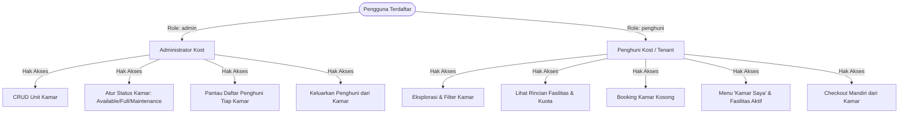
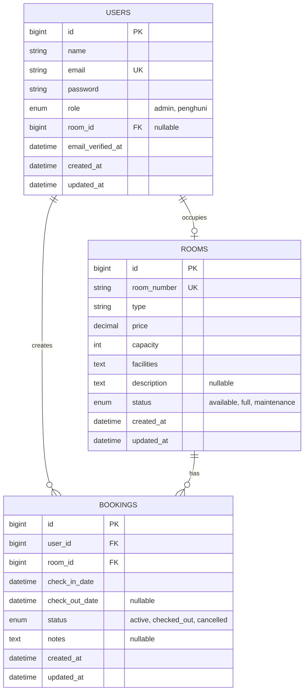
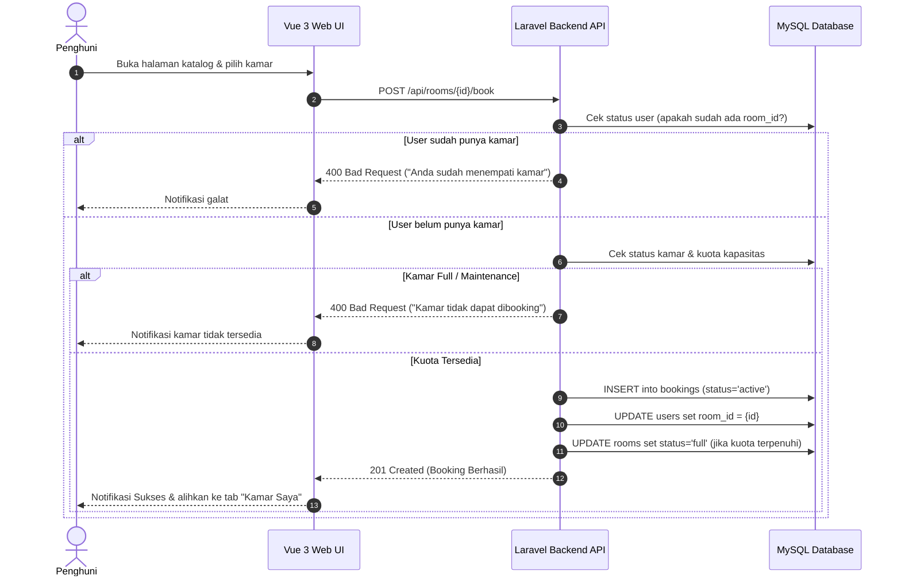
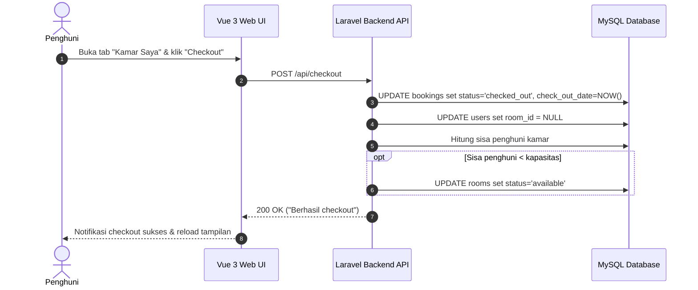

# PRODUCT REQUIREMENT DOCUMENT (PRD)
## Sistem Manajemen dan Pemesanan Kamar Kost (Kostify / Kost Management System)

---

### Informasi Dokumen
- **Nama Produk**: Sistem Manajemen & Pemesanan Kamar Kost
- **Versi Dokumen**: 1.0.0
- **Status Dokumen**: Approved / Baseline Implementation
- **Mata Kuliah**: Pemrograman Lanjut / Evolusi dan Konstruksi Perangkat Lunak (Semester 5 TRPL)
- **Terakhir Diperbarui**: November 2026

---

## 1. Ringkasan Eksekutif & Latar Belakang (Executive Summary)

### 1.1 Latar Belakang
Pengelolaan operasional rumah kost tradisional sering kali menghadapi berbagai kendala efisiensi, antara lain:
- Pencatatan ketersediaan kamar yang masih manual menggunakan buku atau spreadsheet terpisah sehingga rentan terjadi *double booking* atau ketidaksinkronan data ketersediaan kamar.
- Sulitnya calon penghuni atau penghuni aktif dalam memantau spesifikasi kamar, fasilitas yang didapatkan, status penempatan, dan riwayat pemesanan secara transparan dan *real-time*.
- Kurangnya sistem pemantauan terpusat bagi pengelola kost (administrator) untuk memonitor kapasitas kamar, status pemeliharaan (*maintenance*), serta penempatan penghuni di setiap unit kamar.

### 1.2 Solusi yang Dihadirkan
Sistem Manajemen Kamar Kost ini hadir sebagai platform berbasis web terintegrasi dan siap kontainer (*container-native*) yang memfasilitasi kebutuhan dua pemangku kepentingan utama: **Administrator Kost** dan **Penghuni Kost (Tenant)**. Platform ini menyediakan katalog kamar interaktif, proses booking otomatis yang divalidasi terhadap kuota kapasitas, manajemen penempatan penghuni, fitur checkout mandiri, serta didukung oleh infrastruktur modern berbasis Docker Compose dengan kemampuan *observability* (logging terstruktur dan pemeriksaan kesehatan *self-healing*).

---

## 2. Visi Produk, Tujuan, & Tolok Ukur Keberhasilan

### 2.1 Visi Produk
Menjadi sistem manajemen rumah kost yang andal, aman, terotomatisasi penuh dari sisi infrastruktur, dan memberikan pengalaman sewa kamar yang transparan bagi penghuni serta efisien bagi pengelola.

### 2.2 Tujuan Bisnis & Proyek
1. **Otomatisasi Penuh Pemesanan**: Menghilangkan risiko kesalahan manusia (*human error*) dan konflik kuota kamar melalui validasi otomatis ketersediaan dan kapasitas.
2. **Sentralisasi Data Kamar & Penghuni**: Mengintegrasikan seluruh informasi unit kamar, fasilitas, penghuni, dan status pemesanan ke dalam basis data relasional tunggal.
3. **Standarisasi Kontainer & Cloud-Ready**: Memastikan kemudahan replikasi lingkungan pengembangan dan produksi melalui orkestrasi Docker Compose multi-kontainer (*frontend*, *backend*, *database*).
4. **Keandalan & Observabilitas Tinggi**: Menerapkan logging terstruktur (ke *stdout* kontainer), rotasi log otomatis, dan mekanisme *healthcheck* proaktif guna mendeteksi kegagalan basis data atau cache sebelum berdampak fatal pada pengguna.

### 2.3 Tolok Ukur Keberhasilan (Success Metrics / KPIs)
- **Zero Double-Booking**: Tidak ada kamar yang memiliki jumlah penghuni aktif melebihi kapasitas maksimumnya.
- **Latency API**: Waktu respons rata-rata untuk operasi baca dan tulis API di bawah 200 ms pada lingkungan lokal/Docker.
- **Waktu Pemulihan (MTTR)**: Healthcheck kontainer mendeteksi dan melaporkan kegagalan basis data dalam rentang waktu < 15 detik, serta pulih secara otomatis saat layanan basis data kembali menyala.
- **Kepatuhan Privasi Data**: 0% kebocoran token, kata sandi, atau data pribadi (*PII*) pada catatan log sistem.

---

## 3. Pengguna & Persona (Target Audience & Personas)

Sistem mengadopsi kontrol akses berbasis peran (*Role-Based Access Control* / RBAC) yang terbagi menjadi dua aktor:



### 3.1 Persona 1: Administrator Kost (Pengelola)
- **Karakteristik**: Pemilik kost atau staf operasional pengelola properti.
- **Kebutuhan**:
  - Menambah unit kamar baru beserta tipe, harga sewa bulanan, kuota kapasitas, dan daftar fasilitas.
  - Memperbarui data kamar atau mengubah status ke *Maintenance* jika sedang dalam renovasi/perbaikan.
  - Mengetahui siapa saja penghuni yang sedang menempati masing-masing kamar.
  - Mengeluarkan penghuni yang masa sewanya telah berakhir atau melanggar aturan secara manual.

### 3.2 Persona 2: Penghuni Kost (Tenant)
- **Karakteristik**: Mahasiswa atau pekerja yang membutuhkan tempat tinggal sewa bulanan.
- **Kebutuhan**:
  - Melihat katalog kamar yang tersedia, memfilter berdasarkan tipe/status/harga, dan mencari fasilitas tertentu (misal: AC, WiFi).
  - Melakukan pemesanan (*booking*) kamar yang masih memiliki sisa kuota kapasitas.
  - Mengetahui informasi kamar yang saat ini ditempati beserta daftar fasilitas dan teman sekamar (*roommates*).
  - Melakukan *checkout* ketika masa sewa selesai tanpa proses administrasi tatap muka yang rumit.

---

## 4. Arsitektur Sistem & Spesifikasi Teknologi

Sistem dirancang dengan arsitektur decoupled *Single Page Application* (SPA) dan RESTful API, diisolasi dalam satu jaringan internal Docker bridge (`kost_network`):

```text
               +-------------------------------------------------------+
               |                  Klien Web (Browser)                 |
               |                http://localhost:3000                  |
               +---------------------------+---------------------------+
                                           |
                                           | HTTP Requests
                                           v
+--------------------------------------------------------------------------------------+
| Docker Compose Orchestration (kost_network)                                         |
|                                                                                      |
|  +--------------------------------------------------------------------------------+  |
|  | [Service: frontend] (Port Host: 3000 -> Container: 80)                         |  |
|  | - Web Server: Nginx 1.27 Alpine                                                |  |
|  | - Frontend App: Vue 3 (Composition API) + Vite + TypeScript                   |  |
|  | - Reverse Proxy: Melakukan proxy-pass `/api/*` langsung ke `kost_backend:8000` |  |
|  +---------------------------------------+----------------------------------------+  |
|                                          |                                           |
|                                          | Proxy /api/* & Direct Port 8000           |
|                                          v                                           |
|  +--------------------------------------------------------------------------------+  |
|  | [Service: backend] (Port Host: 8000 -> Container: 8000)                        |  |
|  | - App Server: FrankenPHP 1.4 (Caddy Engine) + PHP 8.2 Alpine                   |  |
|  | - Framework: Laravel 12                                                        |  |
|  | - Authentication: Laravel Sanctum (Stateful / Bearer Token)                    |  |
|  | - Observability: Healthcheck (`/health`), Monolog ke `stdout`                  |  |
|  +---------------------------------------+----------------------------------------+  |
|                                          |                                           |
|                                          | TCP Connection (Internal Port 3306)       |
|                                          v                                           |
|  +--------------------------------------------------------------------------------+  |
|  | [Service: database] (Port Host: 3307 -> Container: 3306)                       |  |
|  | - DBMS: MySQL 8.0 Community Server                                             |  |
|  | - Persistent Volume: `mysql_data` (/var/lib/mysql)                             |  |
|  | - Healthcheck: `mysqladmin ping`                                               |  |
|  +--------------------------------------------------------------------------------+  |
+--------------------------------------------------------------------------------------+
```

### 4.1 Rincian Tech Stack
| Lapisan / Komponen | Teknologi | Keterangan & Manfaat |
| :--- | :--- | :--- |
| **Frontend Framework** | Vue 3 (SFC `<script setup>`) | Reaktivitas cepat, performa modular, dan arsitektur komponen bersih. |
| **Language & Tooling** | TypeScript, Vite | *Type safety* saat kompilasi, build sangat cepat (*Hot Module Reload*). |
| **Styling & Icons** | Tailwind CSS / Scoped CSS | Tampilan modern, bersih, adaptif pada desktop maupun perangkat seluler. |
| **Backend Framework** | Laravel 12 | Ekosistem robust, Eloquent ORM, migrasi database, dan middleware fleksibel. |
| **Runtime & Server** | FrankenPHP (PHP 8.2 Alpine) | Server aplikasi berkinerja tinggi berbasis Caddy, *worker mode ready*. |
| **Autentikasi** | Laravel Sanctum | Pengelolaan token API (*Bearer Token*) yang ringan dan aman. |
| **Database Persisten** | MySQL 8.0 | RDBMS berstandar industri dengan integritas referensial dan transaksi ACID. |
| **Kontainerisasi** | Docker & Docker Compose | Penjaminan lingkungan identik antar mesin (*zero environment discrepancies*). |

---

## 5. Kebutuhan Fungsional (Functional Requirements)

### Modul 1: Autentikasi & Akun Pengguna (FR-01)
- **FR-01.1 (Registrasi)**: Pengguna baru dapat mendaftarkan diri dengan mengisi nama, email unik, kata sandi (minimal 6 karakter), serta memilih peran (`penghuni` atau `admin`). Sistem mengembalikan status 201 Created dan token akses.
- **FR-01.2 (Login)**: Pengguna terdaftar dapat masuk menggunakan email dan password. Sistem mengembalikan status 200 OK beserta Bearer Token Sanctum.
- **FR-01.3 (Verifikasi Kredensial)**: Jika kombinasi email/password salah, sistem menolak dengan HTTP 401 Unauthorized dan mencatat log warning terstruktur.
- **FR-01.4 (Logout)**: Pengguna yang terautentikasi dapat mencabut token aktifnya melalui endpoint `/api/logout`.
- **FR-01.5 (Profil Pengguna / Me)**: Pengguna dapat mengambil data profil terkininya (`/api/me`) untuk memperbarui status peran dan penempatan kamar secara reaktif.

### Modul 2: Manajemen Unit Kamar / CRUD Admin (FR-02)
- **FR-02.1 (Tambah Kamar)**: Administrator dapat menambahkan unit kamar baru dengan atribut: Nomor Kamar (unik), Tipe Kamar, Harga Bulanan, Kapasitas (min. 1), Fasilitas, Deskripsi, dan Status Awal. Respons: 201 Created.
- **FR-02.2 (Ubah Kamar)**: Administrator dapat memperbarui data kamar yang sudah ada. Nomor kamar tetap harus unik jika diubah. Respons: 200 OK.
- **FR-02.3 (Hapus Kamar)**: Administrator dapat menghapus data kamar. Bila kamar masih memiliki penghuni, sistem secara otomatis melepaskan relasi penghuni (`room_id = null`) sebelum kamar dihapus. Respons: 200 OK.
- **FR-02.4 (Logika Status Otomatis)**: Status kamar terdiri atas:
  - `available`: Masih memiliki kuota penghuni (jumlah penghuni < kapasitas).
  - `full`: Jumlah penghuni telah mencapai kuota kapasitas.
  - `maintenance`: Kamar sedang dalam perbaikan dan ditutup untuk umum.

### Modul 3: Eksplorasi, Pencarian, & Filter Kamar (FR-03)
- **FR-03.1 (Daftar Kamar Publik)**: Pengguna terautentikasi dapat melihat seluruh katalog kamar lengkap dengan status keterisian dan total penghuni saat ini.
- **FR-03.2 (Pencarian Real-Time)**: Pengguna dapat mencari kamar berdasarkan nomor kamar, tipe kamar, atau kata kunci fasilitas (misal: "AC", "WiFi").
- **FR-03.3 (Filter Status)**: Pengguna dapat memfilter tampilan kamar berdasarkan status (`Semua`, `Tersedia`, `Penuh`, `Pemeliharaan`).
- **FR-03.4 (Detail Kamar)**: Pengguna dapat melihat kartu rincian lengkap mengenai spesifikasi kamar, deskripsi lingkungan, harga sewa, dan daftar fasilitas yang disediakan.

### Modul 4: Pemesanan Kamar / Booking (FR-04)
- **FR-04.1 (Pengajuan Booking)**: Penghuni dapat memesan kamar yang berstatus ketersediaan aktif. Sistem membuat entitas `Booking` baru berstatus `active` dan tanggal `check_in_date = now()`. Respons: 201 Created.
- **FR-04.2 (Aturan Satu Kamar)**: Penghuni yang sudah menempati kamar (`user.room_id !== null`) **dilarang keras** melakukan pemesanan kamar baru sebelum melakukan checkout dari kamar lamanya (Respons: 400 Bad Request).
- **FR-04.3 (Pencegahan Booking Kamar Penuh)**: Kamar yang kapasitasnya sudah penuh ditolak otomatis dengan pesan galat (Respons: 400 Bad Request).
- **FR-04.4 (Pencegahan Booking Kamar Maintenance)**: Kamar berstatus `maintenance` tidak dapat dipesan (Respons: 400 Bad Request).
- **FR-04.5 (Sinkronisasi Otomatis Status Kamar)**: Jika pemesanan menyebabkan jumlah penghuni sama dengan kapasitas, status kamar otomatis beralih menjadi `full`.

### Modul 5: Pemantauan Kamar Saya & Checkout Mandiri (FR-05)
- **FR-05.1 (Tampilan Kamar Saya)**: Penghuni dapat membuka tab menu "Kamar Saya" untuk melihat kamar yang sedang ditempatinya, tanggal mulai sewa, dan informasi teman satu kamar jika kapasitas > 1.
- **FR-05.2 (Checkout Mandiri)**: Penghuni dapat mengklik tombol "Checkout". Sistem akan:
  1. Mengubah status `Booking` aktif menjadi `checked_out` dan mengisi `check_out_date`.
  2. Mengosongkan penempatan kamar pengguna (`user.room_id = null`).
  3. Memulihkan status kamar menjadi `available` jika sebelumnya kamar berstatus `full`.

### Modul 6: Manajemen Penghuni oleh Administrator (FR-06)
- **FR-06.1 (Lihat Penghuni Kamar Tertentu)**: Administrator dapat menginspeksi siapa saja pengguna yang sedang menempati unit kamar tertentu melalui modal detail kamar.
- **FR-06.2 (Keluarkan Penghuni / Evict)**: Administrator memiliki hak untuk mengeluarkan penghuni tertentu dari kamar. Sistem membatalkan booking aktif penghuni tersebut (`status = cancelled`), mengosongkan `room_id`, dan menyesuaikan kembali status kamar.

### Modul 7: Observabilitas, Log Terstruktur, & Healthcheck (FR-07)
- **FR-07.1 (Healthcheck Endpoint `/health`)**: Menyediakan probe kesehatan sistem tanpa ketergantungan sesi/cookie:
  - Memeriksa koneksi PDO dan query basis data MySQL (`SELECT 1`).
  - Memeriksa operasi baca/tulis/hapus pada penyimpanan cache.
  - Mengembalikan status HTTP 200 jika normal, atau HTTP 503 jika basis data atau cache mengalami gangguan.
- **FR-07.2 (Log Terstruktur)**: Mengeluarkan seluruh log aplikasi Laravel langsung ke `stdout` kontainer dengan format terstruktur memuat `who`, `doing`, dan `reason`.
- **FR-07.3 (Privasi Log)**: Melarang keras pencatatan kata sandi, token autentikasi, atau data pribadi (*PII*) ke dalam catatan log.

---

## 6. Kebutuhan Non-Fungsional (Non-Functional Requirements)

### 6.1 Keamanan (Security)
- **Hashing Kata Sandi**: Seluruh kata sandi dienkripsi menggunakan algoritma `Bcrypt` dengan *cost round* = 12 sebelum disimpan ke basis data.
- **Token-Based Protection**: Seluruh rute sensitif diwajibkan menyertakan header otorisasi `Authorization: Bearer <sanctum_token>`.
- **Validasi Server-Side**: Semua input divalidasi ketat di backend menggunakan Laravel Validator; kegagalan validasi mengembalikan kode status HTTP 422 Unprocessable Entity.
- **Pembersihan Log Terstruktur**: Nilai password dan token difilter sehingga tidak pernah muncul di stream log kontainer.

### 6.2 Keandalan & Toleransi Gangguan (Reliability & Resilience)
- **Database Self-Healing Wait**: Skrip `docker-entrypoint.sh` secara cerdas melakukan *polling* koneksi MySQL hingga 30 kali sebelum menjalankan migrasi, mencegah kontainer backend crash akibat database belum siap.
- **Kontainer Restart Policy**: Seluruh layanan dikonfigurasi dengan `restart: unless-stopped`.
- **Data Persistence**: Data MySQL disimpan pada *named volume* Docker `mysql_data` yang terisolasi dari siklus hidup kontainer.

### 6.3 Skalabilitas & Efisiensi Sumber Daya
- **Batas Ukuran Log (Log Rotation)**: Driver log Docker dikonfigurasi dengan `json-file` berukuran maksimum `10m` (`max-size`) dan retensi `3` berkas (`max-file`) untuk mencegah disk host kepenuhan log.
- **Optimasi Aset**: Aset frontend dikompilasi menggunakan Vite ke dalam bentuk statis yang di-*serve* oleh Nginx Alpine yang sangat hemat memori (< 20 MB RAM).

---

## 7. Model Data & Skema Basis Data (Data Model & ERD)



### Kamus Data Entitas Utama:

#### 1. Tabel `users`
| Nama Kolom | Tipe Data | Keterangan |
| :--- | :--- | :--- |
| `id` | `BIGINT UNSIGNED` (PK, Auto Increment) | Pengenal unik pengguna |
| `name` | `VARCHAR(255)` | Nama lengkap pengguna |
| `email` | `VARCHAR(255)` (Unique) | Alamat surel untuk kredensial login |
| `password` | `VARCHAR(255)` | Hash kata sandi (Bcrypt) |
| `role` | `ENUM('admin', 'penghuni')` | Peran pengguna dalam otorisasi sistem |
| `room_id` | `BIGINT UNSIGNED` (FK, Nullable) | ID kamar yang sedang ditempati saat ini |
| `created_at` / `updated_at`| `TIMESTAMP` | Waktu pembuatan & pembaruan data |

#### 2. Tabel `rooms`
| Nama Kolom | Tipe Data | Keterangan |
| :--- | :--- | :--- |
| `id` | `BIGINT UNSIGNED` (PK, Auto Increment) | Pengenal unik kamar |
| `room_number` | `VARCHAR(50)` (Unique) | Nomor/kode identifikasi kamar (misal: "A101") |
| `type` | `VARCHAR(50)` | Jenis tipe kamar (misal: "Standard Single", "VIP Suite") |
| `price` | `DECIMAL(12, 2)` | Harga sewa per bulan dalam Rupiah |
| `capacity` | `INT` | Batas maksimum penghuni kamar (minimal 1) |
| `facilities` | `TEXT` | Daftar fasilitas (misal: "AC, WiFi, Kasur, Lemari") |
| `description` | `TEXT` (Nullable) | Penjelasan detail kamar atau catatan tambahan |
| `status` | `ENUM('available', 'full', 'maintenance')` | Status ketersediaan unit kamar |
| `created_at` / `updated_at`| `TIMESTAMP` | Waktu pembuatan & pembaruan data |

#### 3. Tabel `bookings`
| Nama Kolom | Tipe Data | Keterangan |
| :--- | :--- | :--- |
| `id` | `BIGINT UNSIGNED` (PK, Auto Increment) | Pengenal unik transaksi booking |
| `user_id` | `BIGINT UNSIGNED` (FK) | Relasi ke ID penghuni |
| `room_id` | `BIGINT UNSIGNED` (FK) | Relasi ke ID kamar yang dipesan |
| `check_in_date` | `DATETIME` | Waktu masuk penempatan kamar |
| `check_out_date`| `DATETIME` (Nullable) | Waktu keluar kamar (diisi saat checkout) |
| `status` | `ENUM('active', 'checked_out', 'cancelled')` | Status siklus sewa kamar |
| `notes` | `TEXT` (Nullable) | Catatan pemesanan atau keterangan evict |
| `created_at` / `updated_at`| `TIMESTAMP` | Waktu pembuatan & pembaruan data |

---

## 8. Spesifikasi Antarmuka REST API

Semua request dan response menggunakan format standar JSON. Rute terproteksi wajib menyertakan header:
`Authorization: Bearer <token>`
`Accept: application/json`

### 8.1 Endpoint Autentikasi
| Metode | Endpoint | Hak Akses | Status | Deskripsi Singkat |
| :--- | :--- | :--- | :--- | :--- |
| `POST` | `/api/register` | Publik | `201` / `422` | Mendaftarkan akun baru (admin atau penghuni) |
| `POST` | `/api/login` | Publik | `200` / `401` / `422` | Otentikasi pengguna & pembuatan access token |
| `POST` | `/api/logout` | Terotentikasi | `200` / `401` | Mencabut access token pengguna saat ini |
| `GET` | `/api/me` | Terotentikasi | `200` / `401` | Mendapatkan profil pengguna terotentikasi |

### 8.2 Endpoint Manajemen & Eksplorasi Kamar
| Metode | Endpoint | Hak Akses | Status | Deskripsi Singkat |
| :--- | :--- | :--- | :--- | :--- |
| `GET` | `/api/rooms` | Terotentikasi | `200` | Mengambil seluruh katalog kamar kos |
| `GET` | `/api/rooms/{id}` | Terotentikasi | `200` / `404` | Mengambil detail spesifik suatu kamar |
| `POST` | `/api/rooms` | **Admin Only** | `201` / `422` | Menambahkan unit kamar kos baru |
| `PUT` | `/api/rooms/{id}` | **Admin Only** | `200` / `404` / `422` | Memperbarui data unit kamar kos |
| `DELETE` | `/api/rooms/{id}` | **Admin Only** | `200` / `404` | Menghapus unit kamar kos dari sistem |
| `GET` | `/api/rooms/{id}/occupants` | **Admin Only** | `200` / `404` | Melihat daftar penghuni di kamar tertentu |
| `DELETE` | `/api/rooms/{roomId}/occupants/{userId}` | **Admin Only** | `200` / `404` | Mengeluarkan pengguna dari kamar kos tertentu |

### 8.3 Endpoint Booking & Penempatan Penghuni
| Metode | Endpoint | Hak Akses | Status | Deskripsi Singkat |
| :--- | :--- | :--- | :--- | :--- |
| `POST` | `/api/rooms/{id}/book` | **Penghuni** | `201` / `400` / `404` | Memesan kamar kos yang masih tersedia |
| `GET` | `/api/my-room` | **Penghuni** | `200` | Memantau informasi kamar yang saat ini ditempati |
| `GET` | `/api/rooms/{id}/facilities`| **Penghuni** | `200` / `404` | Mengambil rincian fasilitas kamar tertentu |
| `POST` | `/api/checkout` | **Penghuni** | `200` / `400` | Checkout mandiri dari kamar yang ditempati |

### 8.4 Endpoint Sistem & Pemantauan
| Metode | Endpoint | Hak Akses | Status | Deskripsi Singkat |
| :--- | :--- | :--- | :--- | :--- |
| `GET` | `/health` atau `/api/health` | Publik / Docker | `200` / `503` | Memeriksa integritas MySQL dan Cache |

---

## 9. Alur Pengguna Utama (Key User Flows)

### 9.1 Alur Pemesanan Kamar oleh Penghuni


### 9.2 Alur Checkout Mandiri Penghuni


---

## 10. Konfigurasi Lingkungan Kontainer & Observabilitas

### 10.1 Konfigurasi Healthcheck Docker
Pemeriksaan kesehatan dipasang di `compose.yaml` untuk memastikan orkestrasi mengetahui kesiapan backend secara otomatis:

```yaml
healthcheck:
  test: ["CMD-SHELL", "curl -f http://localhost:8000/health || exit 1"]
  interval: 5s
  timeout: 5s
  retries: 3
  start_period: 15s
```

### 10.2 Mekanisme Logging Terstruktur ke `stdout`
- Log diatur menggunakan driver channel `stdout` pada `backend/config/logging.php`:
  ```php
  'stdout' => [
      'driver' => 'monolog',
      'level' => env('LOG_LEVEL', 'debug'),
      'handler' => StreamHandler::class,
      'handler_with' => [
          'stream' => 'php://stdout',
      ],
      'formatter' => env('LOG_STDOUT_FORMATTER'),
      'processors' => [PsrLogMessageProcessor::class],
  ],
  ```
- **Rotasi Berkas Log**:
  ```yaml
  logging:
    driver: "json-file"
    options:
      max-size: "10m"
      max-file: "3"
  ```

---

## 11. Kriteria Penerimaan & Pengujian (Acceptance Criteria)

| ID Tes | Skenario Pengujian | Hasil yang Diharapkan | Status |
| :--- | :--- | :--- | :--- |
| **AC-01** | Pengguna registrasi dan login dengan kredensial valid | Mengembalikan HTTP 200/201 beserta token Sanctum. Menu aplikasi menyesuaikan peran (*Admin/Penghuni*). | **Lolos** |
| **AC-02** | Login dengan password yang salah | Mengembalikan HTTP 401 dan mencatat log tingkat `WARNING` berisi konteks `who: guest` dan `doing: verifikasi_kredensial_login`. | **Lolos** |
| **AC-03** | Request dengan parameter form tidak valid | Mengembalikan HTTP 422 dan mencatat log tingkat `WARNING` berisi `failed_fields` tanpa mencatat nilai sensitif. | **Lolos** |
| **AC-04** | Admin menambah, mengedit, dan menghapus kamar | Operasi CRUD berhasil di basis data, mengembalikan 201/200, dan mencatat log tingkat `INFO`. | **Lolos** |
| **AC-05** | Penghuni memesan kamar saat sudah memiliki kamar aktif | Sistem menolak dengan HTTP 400 Bad Request. | **Lolos** |
| **AC-06** | Penghuni melakukan checkout dari kamar | Status booking menjadi `checked_out`, `user.room_id` kembali `null`, dan kapasitas kamar bertambah. | **Lolos** |
| **AC-07** | Pemeriksaan endpoint `/health` saat DB & Cache aktif | Mengembalikan HTTP 200 OK dengan format JSON status `healthy`. | **Lolos** |
| **AC-08** | Simulasi service basis data dimatikan (`docker compose stop database`) | Healthcheck mendeteksi kegagalan, status kontainer di `docker compose ps` berubah menjadi `unhealthy`, endpoint `/health` membalas HTTP 503, dan log tingkat `ERROR` tercatat di stdout. | **Lolos** |
| **AC-09** | Pemulihan basis data (`docker compose start database`) | Kontainer secara otomatis kembali berstatus `healthy` tanpa perlu restart kontainer backend secara manual. | **Lolos** |

---

## 12. Rencana Pengembangan Masa Depan (Future Roadmap)

1. **Payment Gateway Integration**: Integrasi dengan Midtrans / Xendit untuk otomatisasi pembayaran sewa bulanan, tagihan listrik/air, dan konfirmasi bukti bayar otomatis.
2. **Pemberitahuan Terotomasi (Push Notifications / WhatsApp Gateway)**: Pengiriman notifikasi pengingat jatuh tempo sewa kamar kost melalui bot WhatsApp atau email berkala.
3. **Pelaporan Masalah / Tiket Komplain (Complaint Ticketing)**: Modul bagi penghuni untuk melaporkan kerusakan fasilitas kamar (misal AC rusak, lampu mati) disertai unggah foto bukti dan pelacakan status perbaikan oleh admin.
4. **Unggah Foto Kamar Multi-File**: Penyimpanan aset gambar kamar secara dinamis menggunakan AWS S3 / MinIO storage.

